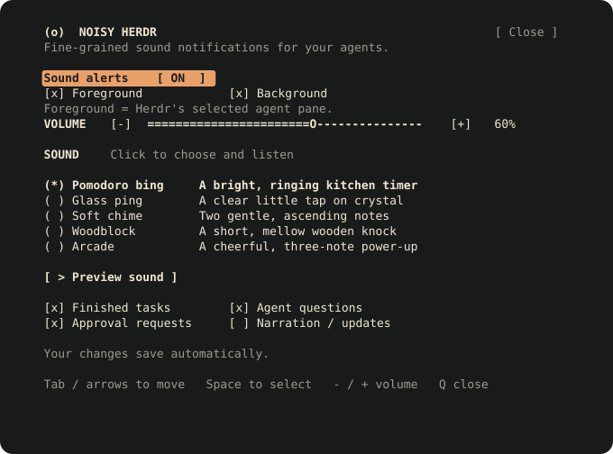

# Noisy Herdr

**Fine-grained control for sound notifications in Herdr.** Choose which events
ring, enable foreground and background sounds independently, and pick the sound
and volume. Five original sounds with previews and mouse controls, including a
Pomodoro-style bing. Python 3.9+; no Python packages to install.



## Install

Install directly from GitHub:

```sh
herdr plugin install engimatic-systems/noisy-herdr
```

Then turn off Herdr's built-in sounds in **Settings > Sound** to prevent
duplicate chimes, and open the plugin's controls with:

```sh
herdr plugin action invoke noisy-herdr.settings
```

Or clone the repository and use the local installer described below.

### Local installation

Requires Herdr **0.9.3 or newer**. On macOS, Python 3 and the built-in `afplay`
are enough. Linux also needs `paplay`, `pw-play`, `aplay`, `ffplay`, or `mpv`.
Linux support is implemented; the integration checks were run on macOS.

From this directory, in your normal terminal:

```sh
python3 noisy-herdr.py install
```

The installer links this folder as a Herdr plugin, saves your preferences,
backs up your Herdr config before changing it, and turns off Herdr's built-in
sounds to avoid duplicate background chimes. It reloads config and opens a
**Noisy Herdr** settings tab without moving your current focus.
Keep this folder in place: Herdr runs the plugin from here.

**Click the settings tab**, then click **Sound alerts** to turn all plugin
alerts on or off. Choose a sound by clicking its row; it previews immediately.
Click anywhere along the volume bar, or use its minus/plus buttons. Changes
save automatically and apply to the next alert. Volume 0 is silent; previews
also use this volume. Preview works even when automatic alerts are switched off.

**Foreground** and **Background** independently control where automatic alerts
may play. Both default to **on**, including when upgrading existing preferences.
Foreground means the agent pane selected inside Herdr; other panes, tabs, and
workspaces count as background. This uses Herdr's native pane selection, so
switching to another app doesn't itself change these categories.

The event category and the foreground/background switch must both be enabled
for a sound to play. Turning both context switches off silences automatic
alerts. Muted events aren't replayed when you re-enable a context. Explicit
previews still play at the selected volume.

The checkboxes independently control these alerts:

| Alert | Default | What rings |
| --- | --- | --- |
| Finished tasks | On | A verified completion after the agent worked |
| Agent questions | On | A question-tool dialog with choices or a free-text answer |
| Approval requests | On | An interactive command or permissions approval dialog |
| Narration / updates | **Off** | Commentary and pauses that Herdr reports as attention or idle |

An ordinary sentence or question mark in narration doesn't count as a question
tool. Leave Narration / updates off to keep progress reports quiet.

The tab stays available while you work in other tabs. Close it when desired;
reopen it with:

```sh
herdr plugin action invoke noisy-herdr.settings
```

Herdr 0.9.3 does **not** let plugins add rows to its built-in Settings dialog
and does not expose plugin actions in its mouse menus. This plugin uses its
own clickable settings tab. Herdr's built-in Sound setting controls Herdr's
own sounds, not this plugin; leave it off and use the Noisy Herdr switch.

## Sounds

| Sound | Character |
| --- | --- |
| **Pomodoro bing** (default) | A bright, metallic kitchen-timer bell with a ringing tail |
| Glass ping | A clear, light tap on crystal |
| Soft chime | Two gentle ascending notes |
| Woodblock | A short, mellow wooden knock |
| Arcade | A cheerful three-note power-up |

The default volume is **60%**. These are synthesized sounds, not recordings
of a particular timer. They use no third-party samples. Listen directly to
[`sounds/pomodoro.wav`](sounds/pomodoro.wav), or preview from the command line:

```sh
python3 noisy-herdr.py preview --sound pomodoro --volume 40
```

The volume is a gain applied only to this plugin's audio. Your computer's
master volume still affects what you hear.

## Behavior and preferences

This is a native Herdr event-hook plugin: no focus spoofing, OS notification
automation, polling daemon, or changes to your agent's own hooks.

It remembers each pane's activity. Before ringing for an attention or idle
event, it reads that specific pane's current agent state and visible detection
text through Herdr's own CLI. A short settling delay and live working footer
prevent a narrated pause from consuming the eventual finished-task alert.
For Codex, completions also require Herdr's current `completion_seq` evidence.

Question and approval detection recognizes the native Codex dialog headings,
choices, and live submit/confirm controls. Herdr 0.9.3 doesn't provide a typed
blocker reason; unfamiliar dialogs from other agents are treated as Narration /
updates rather than guessed to be questions or approvals. These choices depend
on the CLI UI's English text. Terminal text is read on demand, never stored.
If the pane can't be inspected, the plugin stays quiet.

Repeated statuses, unknown detection states, and marking a finished pane as
seen do not cause duplicate alerts. Turning it back on does not replay muted events.
Existing idle agents don't ring on install. The startup/install seed remembers
agents that are already working. As with Herdr's own alerts, results depend on
Herdr detecting the agent's state correctly.

Preferences are shared by local Herdr sessions. Event history is scoped by
server socket so identical pane IDs in different sessions don't collide.
When attached to a remote server, hooks and playback run on that server; this
plugin is intended for **locally running Herdr**, not forwarding remote audio.

Find the preferences directory with:

```sh
herdr plugin config-dir noisy-herdr
```

Its `settings.json` contains:

```json
{
  "enabled": true,
  "volume": 60,
  "sound": "pomodoro",
  "foreground": true,
  "background": true,
  "finished": true,
  "narration": false,
  "questions": true,
  "approvals": true
}
```

Existing `attention` settings migrate automatically to `questions` and
`approvals`. Narration starts off, and your chosen sound, volume, and master
switch are retained. Reopen the settings tab after updating to see the new
checkboxes. Foreground and background are enabled automatically for preferences
saved before those options existed. If a pane's focus is unavailable, alerts
still work with both contexts enabled; with a context restriction, the plugin
stays quiet rather than guessing.

For scripts: `python3 noisy-herdr.py toggle`, `enable`, `disable`, or `status`.
If you want to manage Herdr's built-in sounds yourself, install with
`python3 noisy-herdr.py install --keep-built-in`.

## Remove

Close the plugin's settings tab, then:

```sh
herdr plugin unlink noisy-herdr
```

Re-enable Herdr's original sound in **Settings > Sound** if desired. Your
preferences and original config backup are retained.

## Development

```sh
python3 -m unittest discover -s tests -v
python3 scripts/check_mouse.py
python3 scripts/check_herdr.py
```

Checks use temporary directories and never change your live Herdr setup.
The mouse check launches the real curses UI in a pseudo-terminal and clicks
the controls; previews run at volume zero. The Herdr check uses your installed
binary to validate the manifest and test installation against isolated config.
Audio playback itself requires access to an output device.

Regenerate the committed PCM assets with `python3 scripts/generate_sounds.py`.
Each tone is normalized and fades out cleanly. All source and sounds are MIT
licensed; see [LICENSE](LICENSE).

References: [Herdr plugins](https://github.com/herdrdev/herdr/blob/v0.9.3/docs/next/website/src/content/docs/plugins.mdx),
[event schema](https://github.com/herdrdev/herdr/blob/v0.9.3/src/api/schema/events.rs),
[notification policy](https://github.com/herdrdev/herdr/blob/v0.9.3/src/client/shell/notification_policy.rs).
